  

  

  

  

    
    
    
    
    
  

---

### 👨‍💻 About Me

Hi there! I am **Attala Alif Ramadhani Tri Hida (Atta)**, an undergraduate Information Systems student at **Universitas Trunodjoyo Madura (UTM)**.

I am passionate about engineering high-performance **Mobile Applications (Flutter & Native Android Kotlin)**, researching **Artificial Intelligence & Medical Image Analysis (Deep Learning & Computer Vision)**, and building robust **Web Applications** that solve practical, real-world problems.

- 🎓 **Education**: B.S. in Information Systems — Universitas Trunodjoyo Madura.
- 📱 **Mobile Engineering**: Architecting cross-platform apps with **Flutter** (SmartScanner with OpenCV & Google ML Kit, NoteCraft, PDF Studio Pro) and Native Android with **Kotlin & Jetpack Compose** (AnyDrop Downloader, Melolo AdBlocker Local VPN).
- 🧠 **AI & Deep Learning**: Investigating medical diagnostic modeling (ResNet vs. Vision Transformer on LC25000 lung histopathology, Progressive CNN Ablation Study on thorax CT scans IQ-OTH/NCCD, and 3-tier antenatal risk stratification adhering to KSPR standards with SKI 2023 data).
- 💻 **Web Development**: Developing production-grade MVC web applications with Laravel, PHP, RESTful APIs, and online payment integrations (Midtrans Gateway).
- 📊 **Data Analytics**: Analyzing, modeling, and uncovering actionable insights from complex datasets using Python (Pandas, Plotly), Power BI, and spreadsheets.

---

### 🛠️ Tech Stack & Skills

<table>
  <tr>
    <td align="center" width="160"><strong>📱 Mobile Development</strong></td>
    <td>
      
      
      
      
      
      
      
    </td>
  </tr>
  <tr>
    <td align="center" width="160"><strong>🧠 AI & Data Science</strong></td>
    <td>
      
      
      
      
      
      
      
      
      
      
    </td>
  </tr>
  <tr>
    <td align="center" width="160"><strong>🌐 Web Development</strong></td>
    <td>
      
      
      
      
      
      
      
    </td>
  </tr>
  <tr>
    <td align="center" width="160"><strong>💾 Database & Services</strong></td>
    <td>
      
      
      
      
    </td>
  </tr>
  <tr>
    <td align="center" width="160"><strong>📊 Analytics & Tools</strong></td>
    <td>
      
      
      
      
      
      
      
    </td>
  </tr>
</table>

---

### 🚀 Featured Portfolio Projects

#### 📱 1. Mobile Engineering (Flutter & Native Android)

<table>
  <tr>
    <td width="50%">
      <h3><a href="https://github.com/attaramadhani/APK-smartscanner">📑 SmartScanner (OpenCV + ML Kit)</a></h3>
      
A smart, 100% <em>offline-first</em> document scanner built with Flutter. Powered by <strong>OpenCV</strong> for automatic edge detection, homography perspective correction, and 7 image enhancement filters, alongside <strong>Google ML Kit</strong> for offline Latin OCR, searchable PDF / Word / TXT export, and digital e-signatures.

      

        
        
        
        
      

    </td>
    <td width="50%">
      <h3><a href="https://github.com/attaramadhani/APK-downloader-video-dan-music">⚡ AnyDrop — Video & Music Downloader</a></h3>
      
Native Android application built with <strong>Kotlin & Jetpack Compose</strong> to download media from 1,000+ platforms (YouTube, TikTok, Instagram, X/Twitter, SoundCloud, etc.) via the <em>yt-dlp</em> engine. Features multi-resolution video (360p to 4K), audio extraction (MP3/M4A), background downloads with pause/resume, and Telegram VIP channel media fetching.

      

        
        
        
      

    </td>
  </tr>
  <tr>
    <td width="50%">
      <h3><a href="https://github.com/attaramadhani/APK-block-iklan-APK-Drama-China">🛡️ Melolo & Drama AdBlocker (Local VPN DNS)</a></h3>
      
Native Android application utilizing <strong>Android Local VpnService</strong> in Kotlin to intercept and block aggressive ad network queries (Pangle SDK/ByteDance, Google AdMob, DoubleClick) at the DNS level with 0ms latency and no root access required.

      

        
        
        
      

    </td>
    <td width="50%">
      <h3><a href="https://github.com/attaramadhani/APK-note">📝 NoteCraft — Multi-Dimensional Task Scheduler</a></h3>
      
Modern Flutter note-taking and to-do application crafted with Material 3. Features <em>offline-first</em> SQLite local storage, recurring notification reminders, and multi-dimensional scheduling per task item (Day, Date, Hour, Next Week, Next Month).

      

        
        
        
      

    </td>
  </tr>
  <tr>
    <td width="50%">
      <h3><a href="https://github.com/attaramadhani/APK-I-love-PDF-Clone">📄 PDF Studio Pro (iLovePDF Clone)</a></h3>
      
Comprehensive mobile document manipulation suite offering 25+ PDF tools (Merge, Split, Compress, Convert, OCR text extraction, e-Sign digital signatures, and password protection) with 100% on-device processing to ensure data privacy.

      

        
        
        
      

    </td>
    <td width="50%">
      <h3><a href="https://github.com/attaramadhani/bengkelapp">🔧 Bengkel App (Flutter Mobile)</a></h3>
      
Mobile workshop operations companion app integrated with Supabase cloud database. Supports technician service logging, cashier POS order processing, inventory status tracking, and service history lookup in real-time.

      

        
        
        
      

    </td>
  </tr>
</table>

#### 🧠 2. Artificial Intelligence, Deep Learning & Medical Imaging

<table>
  <tr>
    <td width="50%">
      <h3><a href="https://github.com/attaramadhani/resnet50-vit-lung-histopathology-benchmark">🔬 ResNet-50 vs. ViT Lung Cancer Benchmark</a></h3>
      
In-depth comparative study on optimizer robustness and external validity between Convolutional Neural Networks (ResNet-50) and Vision Transformers (ViT) for lung cancer histopathology classification on the LC25000 dataset.

      

        
        
        
      

    </td>
    <td width="50%">
      <h3><a href="https://github.com/attaramadhani/TUGAS-UTS_DEEP-LEARNING-A">🫁 CNN Progressive Ablation on CT-Scan</a></h3>
      
Progressive ablation study on CNN architectures for lung cancer detection on thorax CT scans (IQ-OTH/NCCD dataset). Evaluates filter variations, batch normalization impact, and regularization techniques on generalizability.

      

        
        
        
      

    </td>
  </tr>
  <tr>
    <td width="50%">
      <h3><a href="https://github.com/attaramadhani/maternal-risk-classification">🩺 Maternal Health Risk Classification</a></h3>
      
Three-tier antenatal risk stratification model (Low Risk / High Risk / Very High Risk) adhering to Poedji Rochjati Score Card (KSPR) standards, trained on the Indonesian Health Survey dataset (SKI 2023).

      

        
        
        
      

    </td>
    <td width="50%">
      <h3><a href="https://github.com/attaramadhani/230441100144_240441100125_DeepLearningA">⚡ Custom CNN vs. Mini-ResNet (CIFAR-10)</a></h3>
      
Experimental benchmark analyzing gradient convergence, training throughput, and generalization capability of conventional Custom CNNs versus Mini-ResNet with residual skip connections on the CIFAR-10 dataset.

      

        
        
      

    </td>
  </tr>
</table>

#### 🌐 3. Web Development & Data Analytics

<table>
  <tr>
    <td width="50%">
      <h3><a href="https://github.com/attaramadhani/Project-Software-Analisis-Harga-Saham-Naik-dan-Turun">📊 AI Stock 360° Institutional Suite</a></h3>
      
Quantitative financial analytics and stock price trend forecasting application built on historical equity market data, equipped with institutional technical indicators and interactive chart visualizations.

      

        
        
        
      

    </td>
    <td width="50%">
      <h3><a href="https://github.com/attaramadhani/bengkel_web">🛠️ Bengkel Web ERP Management</a></h3>
      
End-to-end automotive workshop ERP system powered by Laravel. Features spare part inventory tracking, service billing, multi-role cashier access (Admin & Cashier), and integrated cash and <strong>Midtrans Payment Gateway</strong> processing.

      

        
        
        
      

    </td>
  </tr>
  <tr>
    <td width="50%">
      <h3><a href="https://github.com/attaramadhani/Project-gabut-viral-sosmed-Finger-Move">🖐️ 3D Origami Ribbon Finger Tracker</a></h3>
      
Real-time interactive computer vision installation powered by <strong>MediaPipe Hands</strong> and HTML5 Canvas / Vite. Reconstructs dynamic 3D folded paper origami ribbon paths driven by real-time finger gestures with live visual filters.

      

        
        
        
      

    </td>
    <td width="50%">
      <h3><a href="https://github.com/attaramadhani/klinik_reservasi">🏥 Cliniq — Online Reservation System</a></h3>
      
Online medical clinic booking and digital queue management platform. Enables online patient registrations, doctor schedule coordination across medical departments, and automated queue number issuance.

      

        
        
        
      

    </td>
  </tr>
</table>

---

### 📊 GitHub Activity & Statistics

  

    
    
  

  

    
  

---

### 🤝 Let's Connect & Collaborate!

I am always open to research collaborations, open-source projects, internship opportunities, and professional software engineering discussions.

  
  
  
  

 

  ⭐ Designed & crafted with dedication by <b>Attala Alif Ramadhani Tri Hida</b>. Feel free to star this repository if you find it helpful!

